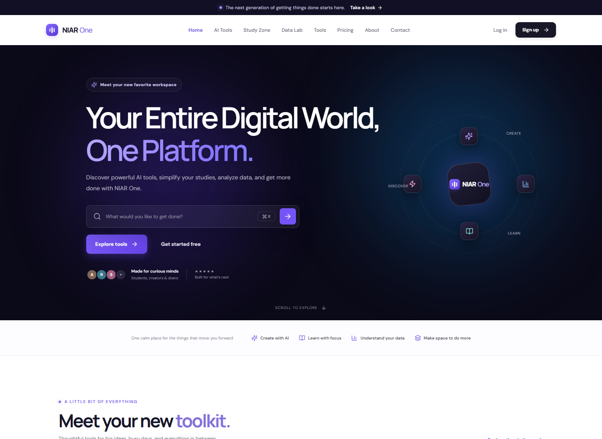

# NIAR One

NIAR One is a responsive productivity application for AI-assisted writing, study organization, browser-based data analysis, and everyday utilities.



## Stack

- Next.js 16 App Router, React 19, TypeScript, Tailwind CSS 4
- Prisma ORM with PostgreSQL; Neon is the recommended managed provider
- Signed HttpOnly session cookies; passwords hashed with bcrypt
- Papa Parse, ExcelJS, Recharts, and browser APIs for Data Lab and utilities

## Windows setup

Requirements: Node.js 20.9+ and npm. From PowerShell:

```powershell
cd C:\Users\Arfan\Desktop\NIAR-One
npm.cmd install
Copy-Item .env.example .env
```

Create a PostgreSQL database (Neon is recommended), then edit `.env` and set `DATABASE_URL` to its connection string. Use Neon's pooled connection string for the app and a direct connection string for schema migrations when available. Replace `SESSION_SECRET` with a cryptographically random value of at least 32 characters. For example, generate one with Node:

```powershell
node -e "console.log(require('node:crypto').randomBytes(32).toString('base64url'))"
```

Set `APP_URL="http://localhost:3000"` for local development. Initialize the generated Prisma client and database, and start the app:

```powershell
npx.cmd prisma generate
npm.cmd run db:migrate
npm.cmd run dev
```

Open <http://localhost:3000>. `npm.cmd` works in PowerShell installations where execution policy blocks `npm.ps1`. For subsequent schema changes, update the Prisma schema and run `npm.cmd run db:migrate`.

## Routes

| Route | Purpose |
|---|---|
| `/` | Landing page |
| `/tools` | Practical browser utility tools |
| `/ai` | AI chat, summarizer, writing, idea, and study-note tools |
| `/study` | Private notes, tasks, flashcards, quiz, and planner |
| `/data-lab` | In-browser CSV and XLSX analysis, cleaning, charts, and exports |
| `/dashboard` | Personal account and usage overview |
| `/pricing` | Sample plan information; no checkout is configured |
| `/about`, `/contact` | Product information and contact form |
| `/login`, `/signup`, `/forgot-password`, `/reset-password` | Account access and password reset |
| `/settings` | Account settings |
| `/admin` | Administrator-only dashboard |

Unknown routes show the app's not-found page. Private pages redirect visitors to login; admin APIs enforce administrator roles independently of the UI.

## Features and limitations

- Sign-up, login, logout, and password hashing are implemented. Sessions use signed, HttpOnly, SameSite cookies; password changes invalidate existing sessions.
- Study items are stored per account in PostgreSQL. Notes, tasks, and flashcards support create, edit, and delete; task completion and due dates are supported.
- Data Lab accepts CSV and `.xlsx` files up to 10 MB, 20,000 rows, and 80 columns. Processing stays in the browser. It previews and filters data, reports missing and duplicate rows, supports cleaning, and exports cleaned CSV/XLSX plus a JSON summary report. Filtering affects the preview and charts only, not the exported cleaned dataset.
- Utility tools run in the browser. Local storage is not used as a substitute for server-side account persistence.
- AI generation requires an OpenAI-compatible endpoint configured with server-only `AI_API_KEY`, and optional `AI_API_URL` and `AI_MODEL`. Without credentials the API returns a configuration error; it does not simulate AI output.
- Password reset email requires SMTP configuration and a valid `APP_URL`. Without it, reset requests report that email delivery is unavailable. Do not use a development SMTP configuration in production.
- Pricing is illustrative. There is no payment provider, billing, or real subscription management; plan buttons do not claim to charge or upgrade an account.
- Contact messages are saved in the database and available to admins. SMTP delivery of contact messages is not configured.
- AI, contact, and password-reset rate limits are in-memory per application process. Use a shared rate-limit store before deploying multiple instances.
- PostgreSQL is required in all environments. Use Neon or another managed PostgreSQL provider for local and deployed environments.

## Optional server configuration

Copy `.env.example` to `.env`; never commit `.env` or expose its values in client code.

### AI

Set `AI_API_KEY`. `AI_API_URL` defaults to the OpenAI-compatible chat-completions endpoint and `AI_MODEL` defaults to `gpt-4o-mini`. The configured provider must accept the standard `messages` request and return `choices[0].message.content`. Keep keys on the server.

### Password reset email

Set `SMTP_HOST`, `SMTP_PORT`, `SMTP_USER`, `SMTP_PASSWORD`, `SMTP_FROM`, and `APP_URL`. Use an HTTPS `APP_URL` in production; local development may use `http://localhost:3000`. Reset tokens are random, stored as hashes, single-use, and expire after 30 minutes.

### Administrator access

1. Sign up normally with the account email you intend to administer.
2. Set `ADMIN_BOOTSTRAP_EMAIL` to that exact email and `ADMIN_BOOTSTRAP_PASSWORD` to the matching account password (at least 16 characters).
3. Run `npm.cmd run db:seed` once. The seed only promotes the existing matching account; it does not create a user or change the password.
4. Remove the bootstrap password from the environment after promotion.

Never add a role field to public signup or grant an admin role based on client input.

## Quality checks

```powershell
npm.cmd run lint
npm.cmd run typecheck
npm.cmd test
npm.cmd run build
npm.cmd audit
```

## Production

Configure the Neon integration (including its direct `DATABASE_POSTGRES_URL_NON_POOLING`
connection variable), a strong `SESSION_SECRET`, HTTPS `APP_URL`, and any required
AI/SMTP credentials in Vercel. Vercel's configured build command runs the committed
Prisma migrations against the direct database connection before building the app.
Review the limitations above before exposing the app publicly.
